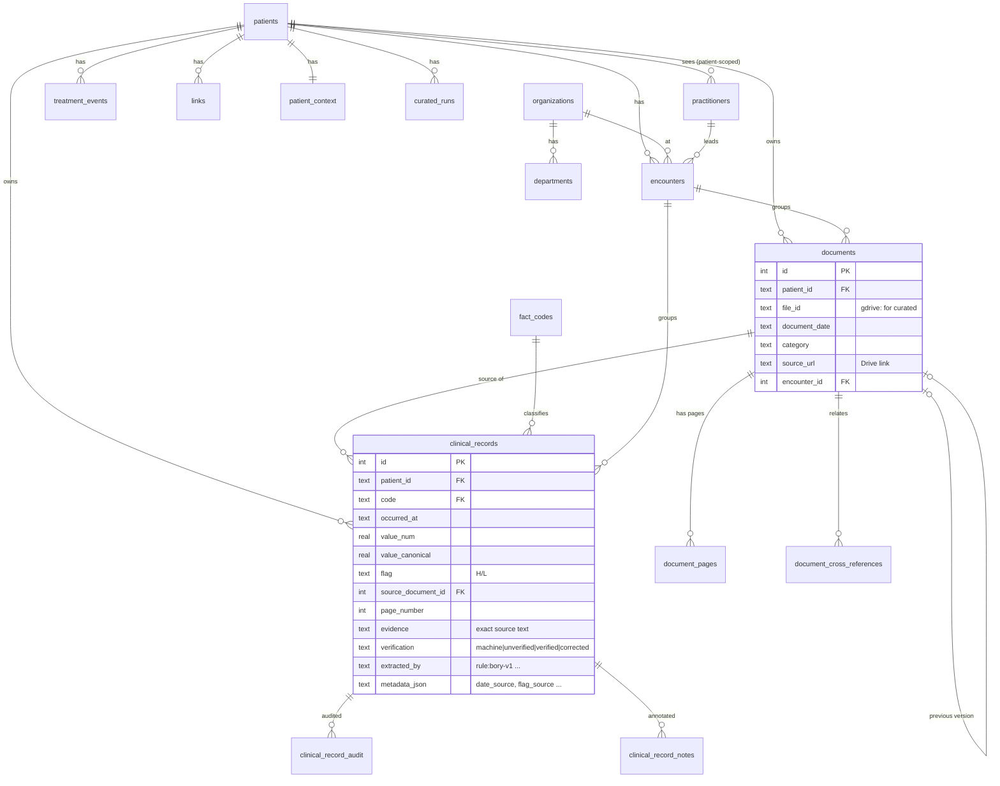
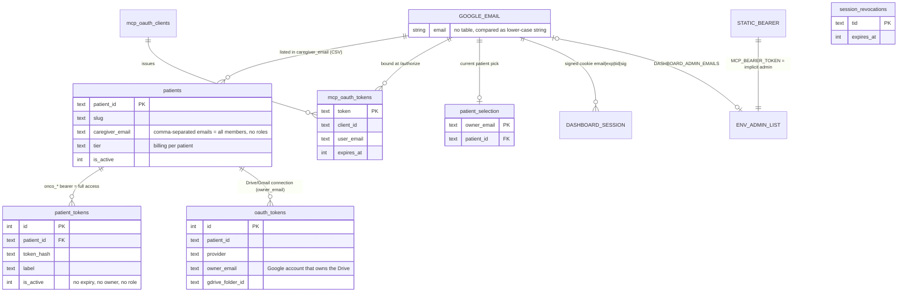
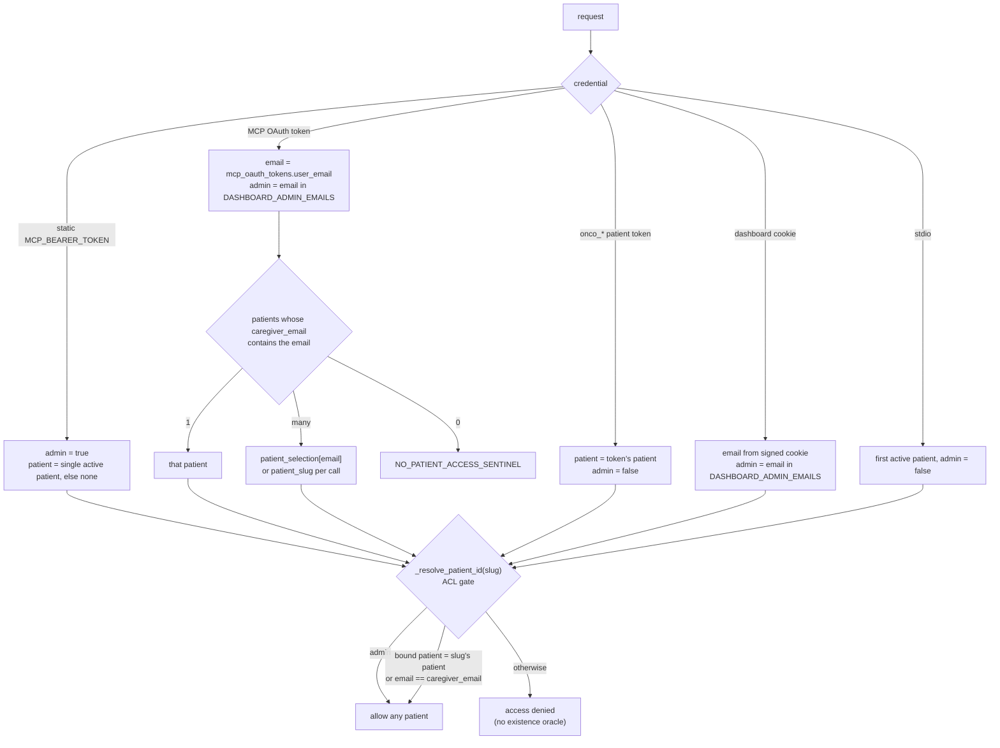
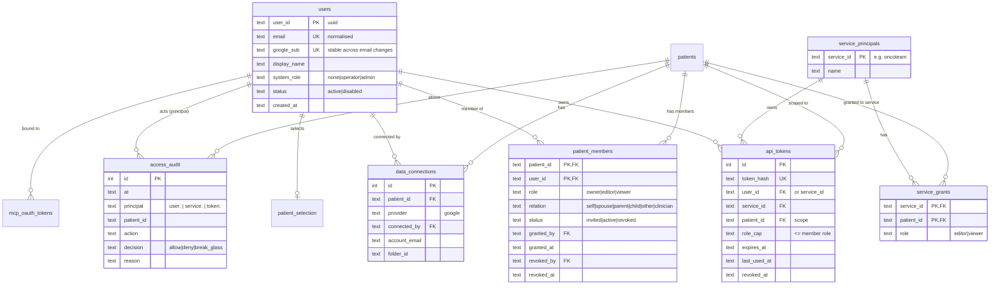
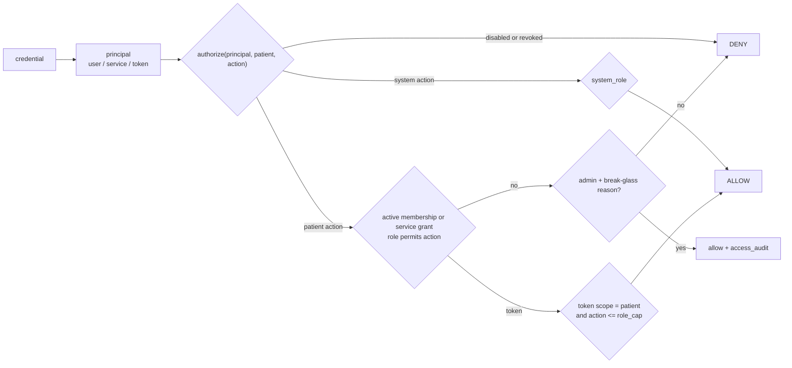
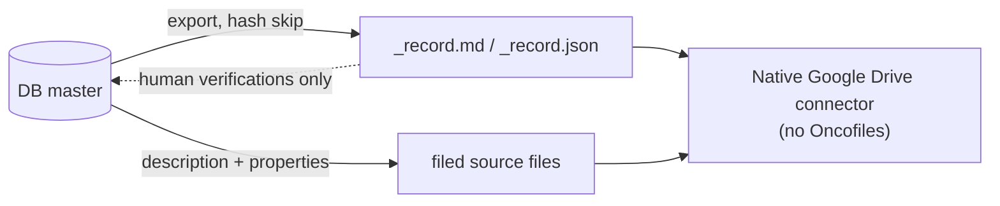

# Data model and access rights

Status: index v9. The diagrams are Mermaid and render on GitHub.
The full column list per table is generated from `migrations/` (73 files). See
"Regenerate the table list" at the end.

Contents:
1. Core model: patients, documents, facts
2. Users and access rights today
3. Target access-rights model (proposal, #650)
4. Drive replica (planned, #616)

---

## 1. Core model

Shared reference data has no `patient_id`: `organizations`, `departments`, `fact_codes`.
Every other table carries `patient_id`, and every query filters on it.
The int-id helpers require `patient_id=` as a keyword (#499).



**Lineage of one value:**
1. Drive inbox.
2. Local OCR.
3. Sidecar `.md`.
4. `documents` + `document_pages` (curated index).
5. `clinical_records`, built by the rule parsers in `curated/facts_rules.py`.
6. `fact_series_v`.
7. MCP `fact_series`: dedupe, statistics over verified values, `latest_any`.
8. The answer in the client, with a Drive link and page number.

---

## 2. Users and access rights today

**There is no user entity.** A user is a Google email string that appears in four unrelated
places. Admin is an environment variable.



### How a request gets its patient



### Gaps in the current model
1. **No users or roles.** Membership is a comma-separated string, and every member has full
   read and write access. Nothing distinguishes a read-only family member, the patient themselves,
   or a second-opinion doctor.
2. **No grant history.** Anyone who already matches `caregiver_email` can PATCH the list:
   add any email, or remove the other members. There is no invitation, consent, `granted_by` or revocation trail.
3. **Admin is overloaded.** `DASHBOARD_ADMIN_EMAILS` is used for system endpoints *and* gives
   full PHI access to every patient (MCP resolver, body ACL). The `_is_admin_email` docstring
   says the opposite ("NOT automatic access to all patients' medical data"). Admin PHI reads
   are not audited.
4. **Inconsistent matching.** The MCP resolver ACL compares `caller_email == caregiver_email`
   as a whole string. Login resolution, `list_patients` and the dashboard split the CSV.
   A second caregiver in the list therefore resolves to the patient by default but is denied
   when they pass `patient_slug`. This fails closed, so there is no leak.
5. **Tokens are owner-less.** `onco_*` patient tokens have no user, no role cap and no expiry.
   The static bearer (Oncoteam) is an implicit admin over all patients, not a service with
   explicit grants.
6. **Three copies of the policy**, in `persistent_oauth.py`, `tools/_helpers.py` and `server.py`.

---

## 3. Target access-rights model (proposal, #650)



### Roles and permissions

| Action | owner | editor | viewer | system operator | system admin |
|---|:-:|:-:|:-:|:-:|:-:|
| Read documents, facts, timeline | ✓ | ✓ | ✓ | – | break-glass, reason + audit |
| Upload, verify/correct facts, notes, treatment | ✓ | ✓ | – | – | break-glass |
| Run curated pipeline / index | ✓ | ✓ | – | – | ✓ (ops) |
| Connect Drive/Gmail, change folder | ✓ | – | – | – | – |
| Invite, change role, revoke members; issue tokens | ✓ | – | – | – | – |
| Archive patient | ✓ | – | – | – | ✓ |
| Health detail, schedules, costs, aggregated logs (no PHI) | – | – | – | ✓ | ✓ |
| Cross-patient tools (`reassign_document`, `query_db`) | – | – | – | – | ✓ audited |

A patient always has at least one `owner`. The last owner cannot leave or be revoked.
`relation` describes the person and grants nothing. `self` marks the patient themselves.

### One decision point



`authorize()` replaces the three current copies. MCP tools, REST endpoints and the dashboard
all call it, and denials keep the current "no existence oracle" response.

### Migration (no behaviour change until the switch)
1. Create the tables. Backfill `users` from every distinct email in `caregiver_email`, `mcp_oauth_tokens.user_email`,
   `patient_selection` and the admin list.
   Every current `caregiver_email` member becomes `owner`, so access is unchanged.
2. Run in shadow mode for one release: `authorize()` runs next to the old checks and logs
   mismatches. Writes to `caregiver_email` are mirrored into `patient_members`.
3. Switch the three call sites to `authorize()`. `caregiver_email` becomes read-only, later dropped
   (no `ALTER TABLE RENAME`, see CLAUDE.md).
4. The owner assigns real roles in the dashboard (invite, role, revoke).

---

## 4. Drive replica (planned, #616)

The database is the master. A derived, read-only copy goes back into the patient's own Drive folder
(`_record.md`, `_record.json`, plus a description and properties on each filed file). An agent
with only the native Google Drive connector can then use the folder without Oncofiles. The copy is
never read back as input, with one exception: human verifications can be restored after a DB loss (#649).



Sub-issues: #644 contract and ignore rules, #645 exporter, #646 writer and triggers, #647 file
metadata, #648 acceptance with the native connector, #649 restore of human verifications.

---

## Regenerate the table list

```bash
python3 - <<'EOF'
import sqlite3, glob
c = sqlite3.connect(":memory:")
for f in sorted(glob.glob("migrations/*.sql")):
    try: c.executescript(open(f).read())
    except Exception: pass  # 043 references a table created later
for (t,) in c.execute("select name from sqlite_master where type='table' and name not like '%fts%' order by 1"):
    print(t, [r[1] for r in c.execute(f"pragma table_info('{t}')")])
EOF
```
